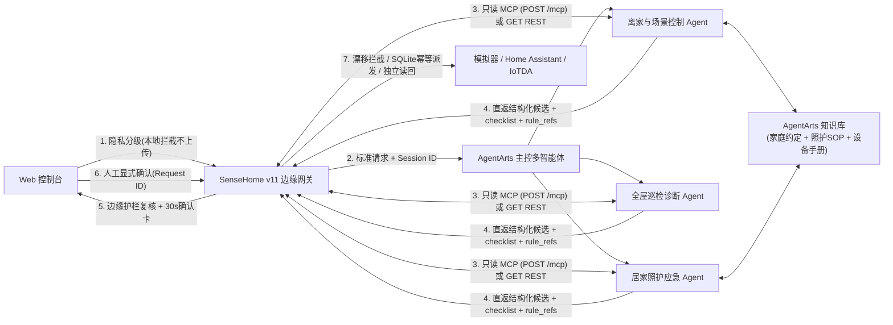

# SenseHome × 华为云 AgentArts（智果）云边协同部署与编排手册

本手册面向华为 ICT 大赛创新赛（赛题 2），采用**“M0 15分钟探针验证 → M1/M2 多智能体 + 知识库 + 纯只读 MCP/HTTP + 边缘安全护栏”**两阶段落地路线，规避多跳 `context` 透传丢失、单工作流僵化与云端越权风险。

---

## 一、架构对比：为什么从 M0 升级为“纯只读工具 + 直返结构化候选”

- **M0 探针阶段（仅用于首轮连通性验收，约 15 分钟）**：
  `开始(query, context) → HTTP POST /api/v1/proposals → 结束(proposal)`
  仅验证华为云 AgentArts 入站 API Key、公网 HTTPS 回调、`SENSEHOME_TOOL_KEY` Bearer 鉴权与 `AGENTARTS_RESULT_PATH`。
- **M1/M2 正式参赛架构（强烈推荐）**：
  1. **云端工具 100% 收敛为只读（Read-Only）**：AgentArts 只需调用 `GET /api/v1/devices`、`GET /api/v1/devices/{id}/state`、`GET /api/v1/care/incidents/{id}`，或直接挂载本仓库内置的 **Streamable HTTP MCP 端点 `POST /mcp`**（携带 `Authorization: Bearer <SENSEHOME_TOOL_KEY>`）。
  2. **多智能体分工清晰**：
     - **中央路由多智能体（Router）**：按意图分发至 3 个专业子智能体/子工作流：
       - **子 Agent 1 (`leave-home-agent`)**：离家动态检查单与家庭约定控制（绑定知识库 `kb_household_rules.md` + `kb_device_manual.md`，调用子工作流/MCP 查设备实时状态）
       - **子 Agent 2 (`inspection-agent`)**：全屋只读巡检与感知诊断（调用设备状态 + 感知摘要工具，永不输出控制动作）
       - **子 Agent 3 (`care-copilot-agent`)**：居家照护 SOS 应急协同（绑定知识库 `kb_care_sop.md`，只读拉取 SOS 事件与房间环境快照生成处置建议）
  3. **直返结构化候选 JSON（免多跳 `context` 透传）**：AgentArts 结束节点直接返回包含 `result_kind`、`intent_type`、`agent_role`、`actions`、`reason`、`rule_refs`、`checklist` 的 JSON 对象。SenseHome 边缘 `web_demo.py` 收到后，执行**边缘确定性护栏校验**（否定/排除硬拦截、目录与能力核对、传感器实时直采复核、全范围含跳过灯的状态依赖绑定）并签发 30 秒有效期的 SQLite 确认卡。



---

## 二、准备隔离的公网 HTTPS 演示网关（华为云 ECS / Flexus + Caddy）

> **安全红线**：公网 HTTPS 仅托管独立软件模拟实例（**切勿加 `--ha-url` 暴露家庭真实内网**）。

1. **启动隔离软件演示网关**（Linux / Windows PowerShell）：
   ```powershell
   Set-Location -LiteralPath 'src/SenseHome-6G/v11'
   $env:SENSEHOME_OPERATOR_KEY = Read-Host '设置网页操作员令牌'
   $env:SENSEHOME_TOOL_KEY = Read-Host '设置 AgentArts 只读工具/MCP 密钥'
   $env:AGENTARTS_TIMEOUT = '60'
   python -X utf8 -B web_demo.py --home demo/cloud_demo --bind 127.0.0.1 --port 8765
   ```
2. **使用 Caddy 一键提供 HTTPS 反向代理**（`/etc/caddy/Caddyfile`）：
   ```caddyfile
   demo.your-domain.com {
       reverse_proxy 127.0.0.1:8765
   }
   ```
3. **验证探针**：从外部设备访问 `https://demo.your-domain.com/healthz`，应返回 `{"status": "ok"}`。
4. **验证标准 MCP 端点**：
   ```powershell
   $headers = @{ Authorization = "Bearer $env:SENSEHOME_TOOL_KEY" }
   $body = '{"jsonrpc":"2.0","id":1,"method":"tools/list","params":{}}'
   Invoke-RestMethod -Uri 'https://demo.your-domain.com/mcp' -Method Post -Headers $headers -ContentType 'application/json' -Body $body
   ```
   确认返回 6 个只读/提案工具且无 `confirm`/`execute` 工具。

---

## 三、华为云 AgentArts 控制台配置步骤

### 步骤 1：配置 MaaS 分级模型（ModelArts Studio）
1. 进入华为云 AgentArts 控制台（如 `西南-贵阳一`）→「管理中心 → 授权管理 → 模型」，开通并鉴权大赛可用 MaaS API Key（注意：正式运行时 API 不能使用控制台免费体验 Token）。
2. **分级模型策略（答辩工程亮点）**：
   - **主控意图路由 / 纯巡检节点**：选用低延迟轻量模型（降低首字与路由耗时）。
   - **离家复合约束推理 / 照护 SOP 研判节点**：选用强推理模型（如 `DeepSeek-V3` / `openPangu` / `Qwen` 旗舰版本），保证中文排除条件、多房间动态筛选和 JSON Schema 严格合规。

### 步骤 2：导入 3 份知识库（RAG）
在 AgentArts「知识库管理」新建知识库 `SenseHome-KB`，上传本目录下的 3 份 Markdown 文件：
- [kb_household_rules.md](file:///e:/1jingsai/ICT/AIC-6G-smarthome/agentarts_assets/kb_household_rules.md)
- [kb_care_sop.md](file:///e:/1jingsai/ICT/AIC-6G-smarthome/agentarts_assets/kb_care_sop.md)
- [kb_device_manual.md](file:///e:/1jingsai/ICT/AIC-6G-smarthome/agentarts_assets/kb_device_manual.md)

按二级标题 `##` 分段并做命中测试：输入“室友还在客厅按平时离家约定检查”，确认 Top-3 召回 `RULE-001`、`RULE-002`、`RULE-003`。

### 步骤 3：接入只读工具（推荐直接注册自定义 MCP，或配置 HTTP 节点）
- **方式 A（推荐，加分项）：Streamable HTTP MCP 接入**
  在 AgentArts「工具 / MCP 管理」注册远程 MCP 服务：
  - URL：`https://demo.your-domain.com/mcp`
  - 鉴权 Header：`Authorization: Bearer <SENSEHOME_TOOL_KEY>`
  - 自动发现 6 个标准工具（`sensehome_list_devices`、`sensehome_get_device_state`、`sensehome_get_household_rules`、`sensehome_get_care_incidents`、`sensehome_get_sensing_status`、`sensehome_validate_proposal`）。
- **方式 B（低代码工作流 HTTP 节点）**：
  - `GET https://demo.your-domain.com/api/v1/devices`
  - `GET https://demo.your-domain.com/api/v1/devices/{entity_id}/state`
  - `GET https://demo.your-domain.com/api/v1/care/incidents/{id}`
  - 统一配置 Header：`Authorization: Bearer <SENSEHOME_TOOL_KEY>`

### 步骤 4：编排多智能体并部署运行时
1. 按 [prompts/multi_agent_prompts.md](file:///e:/1jingsai/ICT/AIC-6G-smarthome/agentarts_assets/prompts/multi_agent_prompts.md) 配置主控多智能体与 3 个子智能体的系统提示词与输出 JSON Schema。
2. 结束节点输出变量命名为 `proposal`（内容为结构化 JSON 对象）。
3. 点击「提交版本 → 部署至实例」，入站鉴权选 `API Key`，并开启**运行数据上报至 APM / AOM**。
4. 将运行时调用 URL 与 API Key 注入本地/云端 `web_demo.py` 环境并重启：
   ```powershell
   $env:AGENTARTS_WORKFLOW_URL = Read-Host '粘贴 AgentArts 运行时 HTTPS 调用地址'
   $env:AGENTARTS_RUNTIME_KEY = Read-Host '输入 AgentArts 运行时 API Key'
   $env:AGENTARTS_RESULT_PATH = 'outputs.proposal'   # 若顶层直接返回 proposal 则设为 proposal
   $env:AGENTARTS_TIMEOUT = '60'
   python -X utf8 -B web_demo.py --home demo/cloud_demo --bind 127.0.0.1 --port 8765
   ```

---

## 四、全链路可观测与平台离线评估
1. **链路追踪关联**：`agentarts.py` 自动在每次请求头发送 `x-hw-agentarts-session-id`，并在前端「云边协同追踪轨迹」面板与 SQLite 审计日志中展示该 `Session ID` 与 `Proposal ID` / `Request ID` 的映射关系，可直接与华为云 APM/AOM Trace 截图一一对应。
2. **50 条冻结基准离线评估**：
   - 将 [eval_benchmark_50.jsonl](file:///e:/1jingsai/ICT/AIC-6G-smarthome/agentarts_assets/eval_benchmark_50.jsonl) 导入 AgentArts「离线评估」模块进行云端评测；
   - 本地可随时运行 `python -X utf8 agentarts_assets/run_eval.py` 复现三组对照（静态 HA 场景 vs 无护栏直出模型 vs SenseHome 分层护栏）量化指标表。
