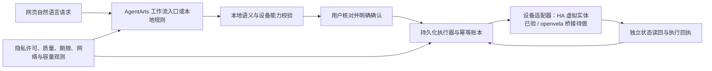

# 华为 ICT 大赛创新赛参赛项目初版

- 版本 0.2 草案
- 日期 2026-11-25
- 状态为网页原型已运行，AgentArts 云端部署待验证

## 1. 项目定位

**拟用名称：智算家居协同引擎**  
**一句话定位：面向家居智能体与集成开发者的可审计任务执行层，让 AI 生成可检查的设备操作提案，由用户授权后安全执行，并以平台读回结果形成持久回执。**

项目目标不是再做一个能聊天的智能音箱，而是解决家居 AI 从“理解指令”到“真实设备动作”之间的可信执行问题：指令含糊、模型选错设备、状态已经变化、重复请求、网络中断或执行结果未知时，系统不能把猜测直接变成家电动作。

## 2. 参赛简介草案

智算家居协同引擎帮助家庭用户核对和追踪 AI 发起的设备操作。系统将自然语言请求整理成包含设备、动作、参数、状态依赖和有效期的提案。用户在网页核对并确认后，运行时派发动作，再独立读取平台状态并保存回执。提案摘要绑定授权内容，持久账本处理重复请求、并发状态变化和结果未知。当前 v11 提供 AgentArts 工作流客户端、设备工具 API、定时灯光和照护模拟，工作流请求及回调通过本地接口验证。CSI 回放、窗帘状态预测、模型候选验证和回滚作为独立的离线试验。真实 AgentArts 实例、实体设备及 CSI 实采仍待验证。

## 3. 方案结构

执行原则：模型仅负责理解和提出候选动作；本地规则检查设备、参数、状态与授权；需要动作时由用户确认；运行时持久记录请求、派发与回执；未确定的结果进入查证和恢复流程，不自动重复执行。

## 4. 核心创新主张

1. **提案与执行分离。** 把自然语言转为有边界的设备操作提案，绑定对象、参数、状态依赖和有效期。未核对、过期或状态变化的提案不能执行。
2. **可恢复的持久执行。** 通过 SQLite 记录授权与执行状态，按请求标识处理重复调用；读回平台状态后形成回执。结果未知时查证，不以自动重试制造重复动作风险。
3. **受约束的智算协同。** 将任务期限、隐私许可、模型质量、网络观测和推理端点容量作为规划服务的选择条件。路由只改变“由谁生成提案”，不能改变本地授权和执行规则。

其中第 1、2 点是项目主创新与答辩重点；第 3 点是技术扩展方向。目前已有对照数据没有证明资源路由优于最佳固定策略，因此不能把“调度提升准确率/时延”写成既成结论。参赛增量应由新实验验证，而不是沿用旧方案中的推断。

## 5. 现有基础与新增工作

| 能力 | 当前证据 | 参赛草案中的处理 |
|---|---|---|
| openvela 家居 Agent | 既有技术基础在 QEMU 环境运行，覆盖自然语言工具调用及若干家居控制流程 | 按参赛者说明，当前项目的名称与内容均已修改，作为独立项目呈现；继续保留底层代码来源、许可证和本次新增贡献的说明 |
| v11 提案、确认、持久执行与查证 | 本地网页已验证灯和窗帘执行读回、阳台灯定时执行、模拟 SOS 确认与升级 | 用同一组操作核对云端工作流、网页确认卡和设备回执 |
| 模型理解能力 | 历史 v9 留出工程集：规则方案完整提案/澄清 60/60，Qwen3-4B 为 34/60，Qwen2.5-1.5B 为 6/60；该集不是外部用户测试 | 规则基线必须保留；模型只生成受约束候选，并报告澄清/拒绝边界 |
| 资源路由效果 | 历史 v6 三策略按期正确数为 52/72、51/72、52/72，未显示联合策略胜过最佳固定策略 | 作为可验证研究问题，不宣称已有收益 |
| 平台和设备 | 历史 v9 在官方 Home Assistant 环境对两个 `input_boolean` 虚拟实体执行服务调用并独立读回；非实体家电。v11 未新增真实模型调用或设备 POST | 参赛演示需区分模拟器、虚拟实体和实物；至少新增一组可复核的设备端验证 |
| 华为 AI 技术 | 已新增 MaaS 请求选项和 openPangu 示例配置，本地 HTTP 已验证生产提案与确认链；公网鉴权探测返回缺 Authorization，当前没有 MaaS API Key | 客户端接线已完成，真实模型调用待凭据；参赛材料暂不能写为已完成真实华为模型验证，详见 `docs/MaaS接入记录.md` |
| openvela 与 v11 的关系 | 本工作区已把 openvela Agent 与 Python v11/Runtime 纳入一个产品源码树；现有材料仍未证明设备侧 Agent 与执行 Runtime 的接口已打通 | 作为同一参赛产品的两个技术组件组织；初版以 v11 可运行链路做 MVP，适配接口列为新增验证工作，不把架构规划写成已完成集成 |

## 6. 参赛演示与验证计划

演示主线采用三个可重复场景：

1. “打开阅读灯和客厅顶灯”：展示多设备解析、提案卡、用户确认、服务执行、平台读回和回执。
2. “关闭书房现在亮着的灯”：展示基于状态的对象选择；若状态不完整，系统澄清而不是猜测。
3. 重复请求、状态变化或执行超时：展示幂等回执、过期提案拒绝、结果未知后的独立查证，以及不盲目重发。

建议设置同一任务集与同一安全约束下的对照：规则基线、华为 AI 直接生成但仅在隔离测试环境运行、华为 AI 加本地安全门、完整提案—确认—执行链。主要指标为任务意图正确率、错误动作实际派发数、应澄清请求的正确拦截率、重复派发数、状态变化后的拒绝率、故障恢复正确率，以及端到端 P50/P95 时延和每任务推理成本。测试任务应在实现前冻结，由人工标注预期动作；仿真结果、虚拟平台结果和实物结果分别报告。

参赛前新增工作优先级：

1. 参赛队已确认报名提交；保存并复核报名回执、队伍成员和指导教师信息。
2. 盘点可用的华为 AI 服务、账号权限和设备平台；先以 Python v11 为 MVP 做最小端到端集成，不在答辩时把计划说成已实现。
3. 补一套小型实物家居验证（例如可控灯具/继电器与状态传感器），保留设备型号、接线、原始日志和失败记录；如硬件来不及，明确演示仍为虚拟平台。
4. 冻结新基准和指标，验证授权、状态变化、重复请求、超时恢复、隐私限制与资源变化。
5. 形成技术文档、代码、演示视频和答辩材料；按当届创新赛具体通知核对文件命名、匿名和大小要求。

## 7. 赛制与合规核对

- 按当前官方页面，目标为第十一届华为 ICT 大赛（2026—2027）中国区创新赛。创新赛考察 AI 与 ICT 综合应用，要求依据赛题使用华为人工智能技术，围绕真实需求设计并实现有创新场景、落地潜力和完整技术架构的方案；比赛为初赛、中国总决赛、全球总决赛三级赛制，需提交技术文档、代码和演示视频，并在后续决赛现场演示答辩。
- 官方创新赛报名页当前显示中国区报名截止 **2026-11-30**；初赛计划在 2026 年 12 月。西安交通大学 2026-10-15 报名通知列中国总决赛为 2027 年 3 月；华为官方手册列全球总决赛为 2027 年 5 月。不同阶段日期以官方报名页和后续赛区通知为准。
- 团队已确认报名提交并确认；本草案未独立核验报名系统回执或队伍信息。
- 官方手册要求报名选手为全日制在校大学生；实践赛、创新赛、编程赛、挑战赛互斥，每人限报一个赛道。手册规定相关参赛队不超过 3 名学生和 1 位指导教师；西安交通大学通知写 3 名学生、1 名指导教师且全队同校，实际报名按官网和所在赛区通知核实。
- 官方手册要求知识产权清晰，并禁止将其他赛事作品在**不加改进**的情况下参赛。按参赛者说明，当前项目已更改名称与内容，并非同一项目；本草案据此将其作为独立项目描述。仍需保留既有开源代码的来源、许可证和本次新增贡献记录，确保作品原创性与权属清楚。西安交通大学通知只适用于其本校组织参赛的队伍，其中更严格的作品条件不直接外推到其他学校；具体资格以参赛队所属赛区及报名审核要求为准。
- 华为官方手册未列创新赛统一评分分值；AIC 专项赛的 35/15/15 等评分表属于另一赛事，不可直接当作华为 ICT 评分标准。

## 8. 主要风险与边界

| 风险 | 当前判断 | 处置 |
|---|---|---|
| 既有资产复用与原创边界 | 需要区分可复用开源代码、第三方组件和当前项目新增内容 | 保留来源、许可证、改动清单与贡献记录；资格按本队所属赛区规则核验 |
| 华为 AI 真实调用待验证 | MaaS 客户端与本地 HTTP 测试已接通，当前缺 API Key，尚无真实模型成功响应 | 凭据在本机配置后完成真实提案调用并保存原始证据 |
| 设备验证不够真实 | 当前强证据主要为软件测试和虚拟实体 | 增加实物设备验证；无法完成时严格标注虚拟平台范围 |
| 宣称 6G/路由收益 | 现有证据不支持 | 不称为 6G 实网验证，不声称路由已提升成功率；以新增对照回答问题 |
| 开源底座与新增贡献边界 | 需区分 Apache-2.0 原有代码、第三方组件和本队新代码 | 保留许可证、NOTICE、改动清单和贡献记录 |

## 9. 需团队确认

1. 报名已提交并确认；请复核报名回执、队伍是否为 3 名同校学生加 1 名指导教师，以及每位成员的赛道互斥资格。
2. 团队对 openvela 底座、本次新增模块与项目名称/内容变更的对应关系，是否有完整的版本记录和许可证材料。
3. 团队实际可用的华为 AI 服务、账号权限、云资源和实物设备是什么；当前默认以 Python v11 为 MVP，资源确认后再决定是否增加 openvela 适配。

## 10. 参考来源

### 官方与赛制

- 华为 ICT 大赛官方报名页（创新赛报名时间与赛道说明）：https://e.huawei.com/cn/talent/ict-academy/#/ict-contest?compId=85132018
- 华为《华为 ICT 大赛手册 2026—2027》官方页面：https://e.huawei.com/cn/documents/others/d669576d54064e609b5b87924aa24be2
- 西安交通大学软件学院《华为 ICT 大赛 2026—2027 报名通知》（赛程与队伍要求的高校通知）：https://se.xjtu.edu.cn/info/1043/4027.htm

### 本地项目材料

- [openvela 设备组件说明](src/openvela_smart_home/README.md)
- [v11 运行说明](src/SenseHome-6G/v11/README.md)
- [MaaS 配置与验证记录](docs/MaaS接入记录.md)
